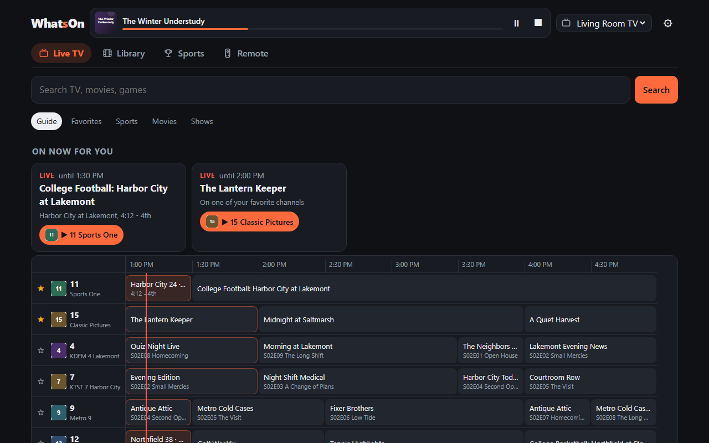
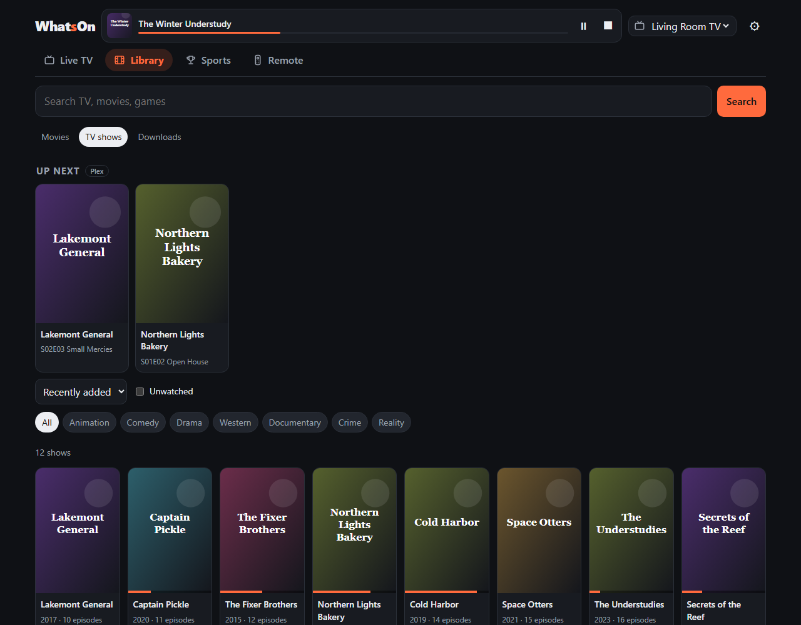
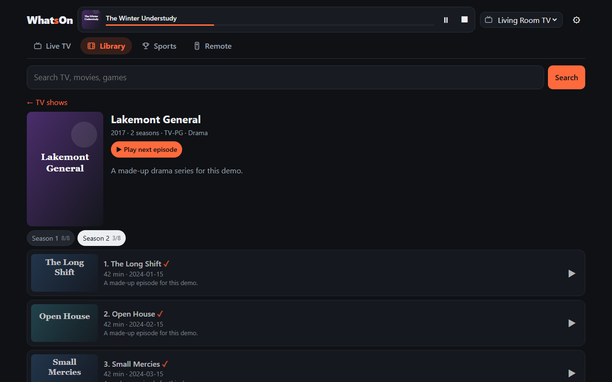
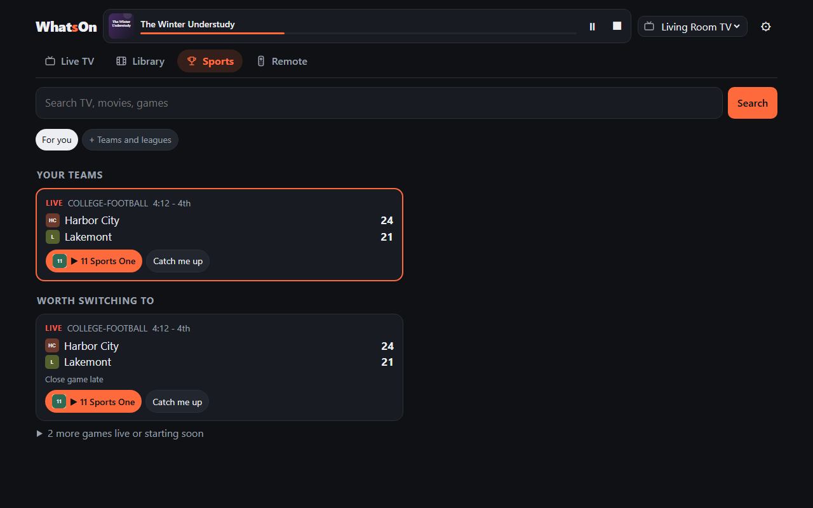
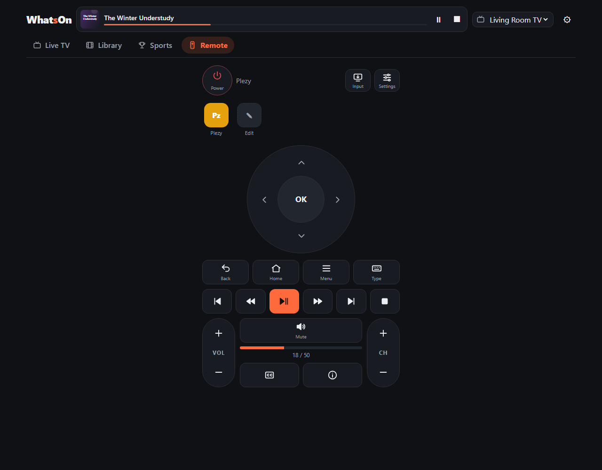
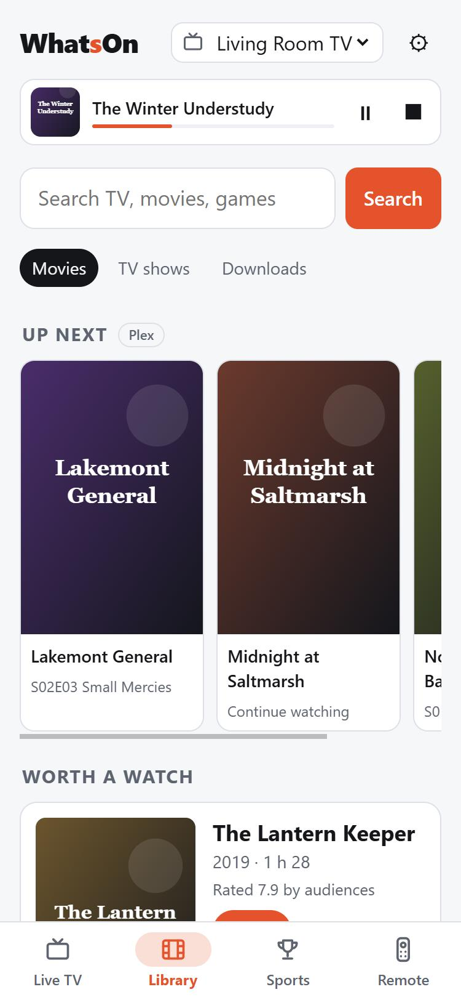

# WhatsOn

Search what's on Live TV and in your Plex library, then put it on a TV with one tap.

Plex's Live TV guide is hard to search: you can't type "illini" and find the game, because guide
listings say "Live: College Football". WhatsOn reads your Plex guide, matches sports listings to
real games (teams, live scores) and lets you search across the guide and your library. Pick a TV and
it tunes the channel or starts the movie there.

## What it does



| Library | Show page |
|---|---|
|  |  |

| Sports | Remote | On a phone |
|---|---|---|
|  |  |  |

The titles, channels, teams and artwork in these screenshots are made up for the demo.

One search bar across everything (live TV, games, your library, titles you could get), four sections,
and a **now playing** bar for the TV you picked (what's on it, progress, pause and stop).

- **Search**: type a title, a team or a channel number (which jumps to that channel in the guide).
  With AI on, you can ask in plain words.
- **Live TV**: a guide grid (desktop) or now/next list (phone), favorite channels, filters for sports,
  movies and shows, and a row of what's on now, picked for you.
- **Library**: Movies and TV shows as posters with sort, genres and an unwatched filter; show pages with
  seasons and episodes; "up next" from Plex's on-deck and a pick for tonight.
- **Remote**: power, d-pad, playback, volume, channels, typing, and an app row per TV.
  A TV can't list its installed apps, so the row learns what it sees in front and lets you tick the rest.
- **Get movies and shows you don't have (optional)**: connect Radarr and/or Sonarr in ⚙ → Downloads.
  Searches then add rows of matching titles you don't own; one tap opens a sheet to add
  it (quality, folder, which episodes, anime routing pre-filled from your settings) and start a search.
  Library → Downloads follows each title through downloading until it's in Plex, then it's a Play button.
  WhatsOn only adds and searches; it never edits or deletes anything in Radarr or Sonarr. A switch in
  ⚙ → Downloads turns adding off; while it's on, anyone who can open WhatsOn can add.
- **Sports**: follow leagues and teams; your teams pinned on top with live scores, last result and next
  game (following a college team covers that school's football and basketball); close games worth switching to; "catch me up" recaps; scores refresh every 30 s while you follow a live game.
- **AI (optional)**: Claude, OpenAI, OpenRouter, or a local OpenAI-compatible server (LM Studio, Ollama).
  It reads questions like "something funny the kids and I can watch tonight, under 2 hours" into filters
  you can edit as chips, writes a one-line answer from the matches only, ranks suggestions with a reason,
  and summarizes games. It never invents results, and everything works without it.
- **Tune a TV**: opens the channel or title in [Plezy](https://github.com/edde746/plezy) on the TV.
  Before taking over a TV it checks whether something is already playing there and asks first.

## Requirements

- Plex Media Server with Live TV & DVR set up (any tuner or guide source). Search and the library work
  without Live TV; the guide needs it.
- For tuning: a Google TV / Android TV device (Chromecast with Google TV, NVIDIA Shield, Google TV
  sets) with **Plezy** installed and signed in. See [Which apps can play](#which-apps-can-play).

## Run it

With the prebuilt image (amd64 and arm64, so a 64-bit Raspberry Pi works):

```bash
mkdir whatson && cd whatson
curl -fsSLO https://raw.githubusercontent.com/whatson-app/whatson/main/compose.yaml
curl -fsSL https://raw.githubusercontent.com/whatson-app/whatson/main/.env.example -o .env
docker compose up -d
```

Update later with `docker compose pull && docker compose up -d`. To pin a version, change `latest` in
`compose.yaml` to a [release number](https://github.com/whatson-app/whatson/pkgs/container/whatson).

Or build it yourself from a checkout:

```bash
cp .env.example .env
docker compose up -d --build
```

Open `http://<host>:8430`. The first time, ⚙ **Plex** opens: press **Sign in with Plex**, approve
WhatsOn on plex.tv and pick your server. Then in ⚙ **TVs**: add each TV by IP address, press **Pair**
and type the code the TV shows. Pairing uses the Android TV Remote protocol (the one the Google TV
phone app uses); no developer mode or ADB is needed.

The container uses host networking so it can reach TVs on your LAN.

## Connecting to Plex

Three ways, in the order WhatsOn prefers them:

1. **Sign in with Plex** (⚙ → Plex). Plex's own sign-in: you approve WhatsOn on plex.tv, and WhatsOn
   never sees your password. It shows up as "WhatsOn" under Plex → Settings → Authorized Devices.
   Under the hood it uses Plex's newer JWT sign-in (a key kept by WhatsOn, renewed every few days).
   Plex Media Server doesn't accept those tokens yet, so for the server itself WhatsOn uses the server
   token plex.tv lists for your account.
2. **Paste a token** (⚙ → Plex → Paste a token instead), for setups where the sign-in pop-up can't work.
   In Plex Web, open any item → Get Info → View XML and copy `X-Plex-Token` from the address bar.
3. **`PLEX_URL` and `PLEX_TOKEN`** in `.env`, for headless setups. Used only when nothing is saved in ⚙ → Plex.

Be aware: if you own the server, any of these tokens can do everything you can on it. WhatsOn only
reads (guide, library, sessions, artwork), but nothing on Plex's side limits it to that. A friend's
shared account gets only what you shared with them.

## Which apps can play

WhatsOn starts playback by sending the TV an app link. Today only one app takes that link and plays:

| App on the TV | What WhatsOn can do |
|---|---|
| [Plezy](https://github.com/edde746/plezy) | Everything: tune Live TV channels and play library titles. Paid on Google Play, free from its GitHub releases. |
| Plex (official) | Open it and use the Remote keys. Since the 2026 redesign the Android TV app doesn't accept remote "play this" commands. |
| Jellyfin apps | Remote tab only: with a Jellyfin server connected (⚙ → Jellyfin), pause, seek and skip whatever is playing, including third-party apps that allow remote control. WhatsOn doesn't start titles in them. |
| Anything else | The Remote keys work with every app. |

Google TV also stopped letting other apps open apps by name (August 2026 Play Store update), so WhatsOn
can only open apps that have a link: Plezy, Plex, YouTube, Netflix and other big streaming apps. Apps
without one (Jellyfin, Kodi) may not open from the app row on Google TV; older Android TV devices may still allow it.

**TVs:** only Google TV / Android TV for now. Roku, Fire TV and others need a driver; see
[Development](#development). Pull requests welcome.

## Security

- **There is no login.** Anyone who can open WhatsOn can change its settings, pair and control TVs,
  and (when ⚙ → Downloads allows it) add movies and shows to Radarr and Sonarr, which start downloading.
  Keep it on your home network. Don't port-forward it or put it behind a public reverse proxy.
- Keys and tokens are kept in WhatsOn's database in the data folder (`/data`) and are never sent to the
  browser. Protect that folder like a password file.
- Requests that change things need a header browsers won't send cross-site, and unknown host names are
  refused (see `ALLOWED_HOSTS`), so other web pages can't drive WhatsOn through your browser.
- Addresses typed in Settings (Plex, Radarr, Sonarr, Jellyfin, a local AI server) are checked on every request:
  LAN and loopback are fine, cloud-metadata and link-local addresses are refused, and redirects aren't
  followed, so a saved key only ever goes to the server it was saved for.

## How tuning works

WhatsOn sends the TV an app link, the same way the Google TV remote app opens apps:

- Live TV: `plezy://live?channel=<number>&start=live`
- Library: `plezy://play?server=<server id>&id=<item id>`

A link replaces whatever is playing on that TV, which is why the busy check exists.

## Data sources

- Guide, channels and library: your Plex server.
- Sports teams and scores: ESPN's public scoreboard feed. It is **unofficial and undocumented** and
  may change without notice. Games are matched to listings by TV network and kickoff time, or by both
  team names appearing in the channel or listing.

## Development

```bash
python -m venv .venv && .venv/bin/pip install -e ".[dev,anthropic,openai]"
DATA_DIR=./data .venv/bin/uvicorn whatson.app:app --reload    # then ⚙ → Plex
.venv/bin/pytest
```

New TV types implement `whatson/devices/base.py:TVDriver` and register in `whatson/app.py`.
See [CONTRIBUTING.md](CONTRIBUTING.md).

## License

MIT. See [LICENSE](LICENSE).
