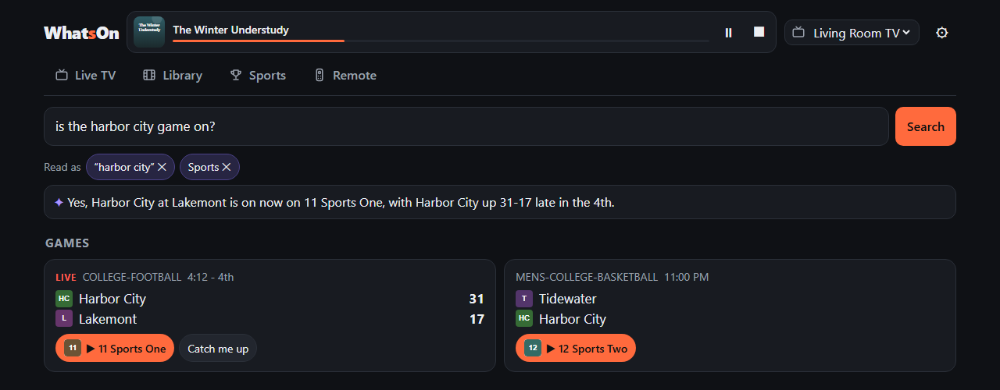
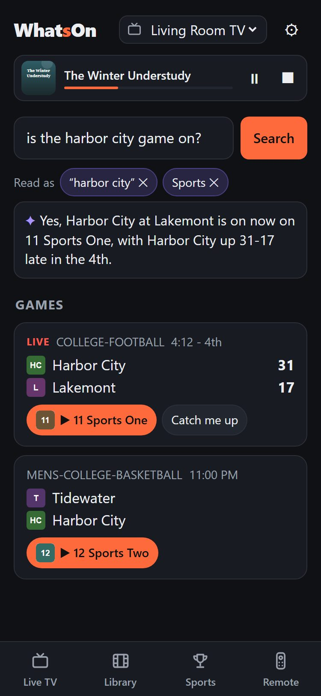
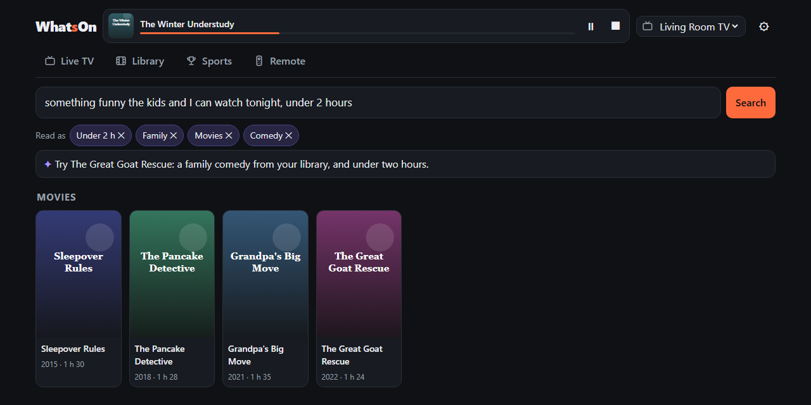
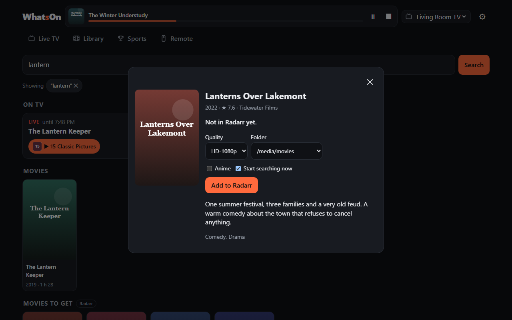
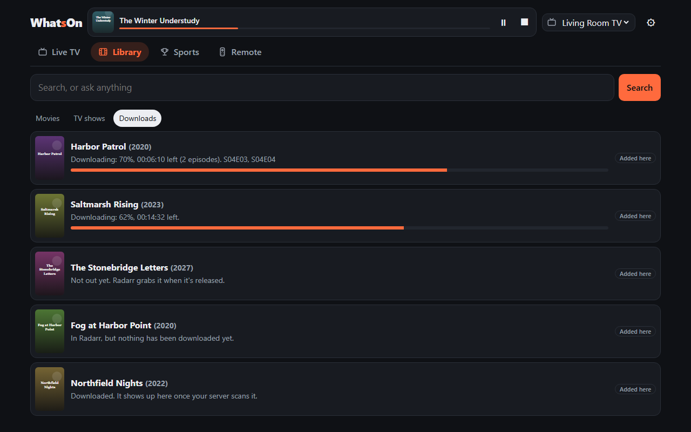
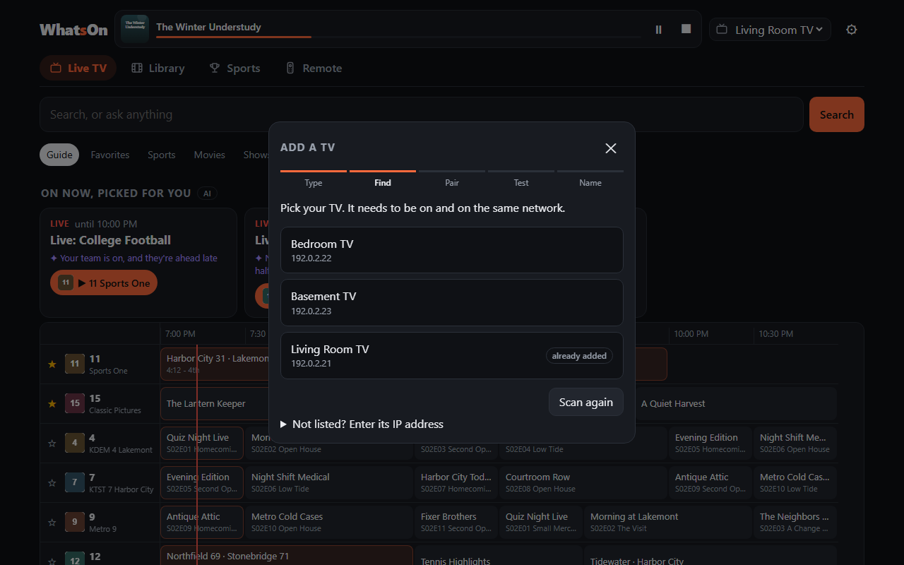
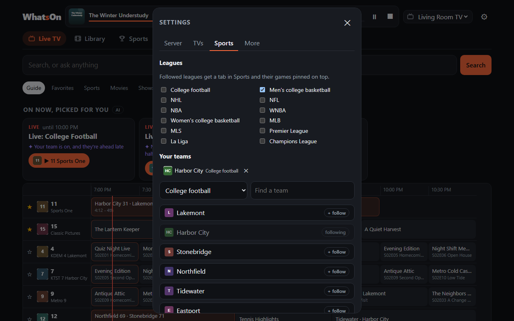

<p align="center"></p>

<h1 align="center">WhatsOn</h1>

<p align="center">In Plezy, search what's on Live TV and in your Plex or Jellyfin library, then put it on a TV with one tap.</p>

<p align="center">
  <a href="#features">Features</a> ·
  <a href="#settings-at-a-glance">Settings</a> ·
  <a href="#run-it">Run it</a> ·
  <a href="#security">Security</a>
</p>



Live TV guides are hard to search: you can't type "gators" and find the game, because guide
listings say "Live: College Football". WhatsOn reads your server's guide, matches sports listings to
real games (teams, live scores) and lets you search across the guide and your library. Pick a TV and
it tunes the channel or starts the movie there.

> **You need [Plezy](https://github.com/edde746/plezy) on each TV.** WhatsOn starts everything on a TV through
> that app, and Plezy has to be signed in to the same server. Without it, WhatsOn can search and work as a
> remote, but it can't start anything. See [Requirements](#requirements).

The titles, channels, teams and artwork in these screenshots are made up for the demo.

## Features

### Search

One search bar across live TV, games, your library and titles you could get.

- Type a title or a team to find it, wherever it is.
- Type a channel number to jump to that channel in the guide.

### Live TV


- A guide grid on a computer, and a now and next list on a phone.
- Favorite channels, and filters for sports, movies and shows.
- A row of what's on now, picked for you.

### Library

| Browse | Show page |
|---|---|
|  |  |

- Movies and TV shows as posters, with sort, genres and an unwatched filter.
- Show pages with seasons and episodes.
- "Up next" from your server, and a pick for tonight.

### Sports


- Your teams pinned on top, with live scores, the last result and the next game.
- Following a college team covers that school's football and basketball.
- Each league you follow gets its own tab.
- Close games worth switching to, and "Catch me up" recaps.
- Scores refresh every 30 seconds while a team or league you follow is playing, otherwise every 5 minutes (`SPORTS_REFRESH_MINUTES`). [How scores refresh](docs/adr/0026-how-sports-scores-refresh.md).

### Remote and tuning

| Remote | On a phone, light | On a phone, dark |
|---|---|---|
|  |  |  |

- **Now playing:** a bar for the TV you picked, with what's on it, progress, pause and stop.
- **Remote:** power, d-pad, playback, volume, channels, typing, and an app row per TV. A TV can't list its
  installed apps, so the row learns what it sees in front and lets you tick the rest.
- **Tuning:** opens the channel or title in [Plezy](https://github.com/edde746/plezy) on the TV. If something is
  already playing there, WhatsOn asks before taking over.

## Optional extras

WhatsOn works without either of these.

### AI search



Use Claude, OpenAI, OpenRouter, or a local OpenAI-compatible server (LM Studio, Ollama). Set it up in ⚙ → More → AI search.

- Ask in plain words. A question like "something funny the kids and I can watch tonight, under 2 hours" becomes
  filters you can edit as chips.
- It writes a one-line answer from the matches only, ranks suggestions with a reason, and summarizes games.
- It never invents results. [How AI works](#how-ai-works) lists exactly what it's sent.

### Trakt

Connect Trakt in ⚙ → More → Trakt. You make your own free API app at
[trakt.tv/oauth/applications](https://trakt.tv/oauth/applications) (redirect URI `http://localhost`), paste its
client ID (and its secret, if your app is old enough to have one), then approve WhatsOn with a code.

- Live TV gets "Your shows on tonight": new episodes of shows you watch, and watchlist movies, in the guide.
- Library gets "Up next" from Trakt and a row of watchlist titles you don't own, with "Get it" when Radarr or Sonarr is
  connected.
- Suggestions use your watchlist, Trakt's recommendations, your ratings and what you've been watching.
- A TV with its own Plex Home user skips Trakt, because Trakt follows one account.

### Get movies and shows you don't have

| Add a title | Follow its download |
|---|---|
|  |  |

Connect Radarr, Sonarr or both in ⚙ → More → Downloads.

- Searches add rows of matching titles you don't own, unless the question was only about live TV.
- One tap opens a sheet to add a title and start a search. Quality, folder, which episodes and anime routing are
  filled in from your settings.
- Library → Downloads follows each title until it's in your library, then it's a Play button.
- WhatsOn only adds and searches. It never edits or deletes anything in Radarr or Sonarr.
- A switch in ⚙ → More → Downloads turns adding off. While it's on, anyone who can open WhatsOn can add.

## Settings at a glance

Everything is set up in the web page, under ⚙.

| Where | What it gives you | Do you need it? |
|---|---|---|
| **Server** | Connect Plex or Jellyfin and choose which to use. WhatsOn reads one at a time. Jellyfin can also just power the Remote tab, while Plex stays your source. | Yes |
| **TVs** | Add and pair TVs, rename them, and check whether one is on and free to tune. | To tune or use the remote |
| **Sports** | Follow leagues and teams. | Optional |
| **More → AI search** | Choose a provider and model, then try a question to test it. | Optional |
| **More → Trakt** | Connect Trakt for your shows airing tonight, your watchlist, "Up next" and suggestions that know your taste. Needs your own free Trakt API app. | Optional |
| **More → Downloads** | Connect Radarr and Sonarr, set default folders and quality, and turn adding on or off. | Optional |
| **More → Appearance** | Match your device, or always use light or dark. Saved per browser, so each phone or computer can differ. | Optional |

| Adding a TV | Sports settings |
|---|---|
|  |  |

## Requirements

- Plex Media Server or a Jellyfin server (tested on 12.4). Search and the library work without Live TV;
  the guide needs Live TV set up on the server (any tuner or guide source).
- For tuning: a Google TV / Android TV device (Chromecast with Google TV, NVIDIA Shield, Google TV
  sets) with **Plezy** installed and signed in to the same server. See [Which apps can play](#which-apps-can-play).

## Run it

> **There is no login.** Keep WhatsOn on your home network. Don't port-forward it or put it behind a public reverse
> proxy. See [Security](#security).

With the prebuilt image (amd64 and arm64, so a 64-bit Raspberry Pi works):

```bash
mkdir whatson && cd whatson
curl -fsSLO https://raw.githubusercontent.com/whatson-app/whatson/main/compose.yaml
curl -fsSL https://raw.githubusercontent.com/whatson-app/whatson/main/.env.example -o .env
docker compose up -d
```

The container uses host networking so it can reach TVs on your LAN. Then:

1. Open `http://<host>:8430`.
2. The first time, ⚙ **Server** opens. Choose Plex or Jellyfin and [connect it](#connect-your-server).
3. In ⚙ **TVs**, press **Add a TV** and pick your TV from the ones WhatsOn finds on your network. If it isn't
   listed, enter its IP address.
4. Type the code the TV shows. Pairing uses the Android TV Remote protocol (the one the Google TV phone app uses);
   no developer mode or ADB is needed.
5. Open Plezy on the TV to test it. WhatsOn tells you if Plezy didn't open.

Update later with `docker compose pull && docker compose up -d`. To pin a version, change `latest` in
`compose.yaml` to a [release number](https://github.com/whatson-app/whatson/pkgs/container/whatson).

<details>
<summary><b>Build it yourself</b></summary>

From a checkout:

```bash
cp .env.example .env
docker compose up -d --build
```

</details>

<details>
<summary><b>Run it on Unraid</b></summary>

Use the Docker template: copy [`deploy/unraid/whatson.xml`](deploy/unraid/whatson.xml) to
`/boot/config/plugins/dockerMan/templates-user/my-whatson.xml`, then go to Docker → Add Container and pick
**whatson**. The container then shows like any other Unraid app (update check, autostart, Edit), not as "3rd Party".

</details>

<details>
<summary><b>Settings in <code>.env</code></b></summary>

You can set Plex, Radarr, Sonarr and AI search in ⚙ instead, and values saved there win over `.env`. The others
are only set here. [`.env.example`](.env.example) explains each one.

| Setting | What it's for |
|---|---|
| `ALLOWED_HOSTS` | Host names you open WhatsOn by, if you use a DNS name or a reverse proxy. IP addresses and `localhost` always work. |
| `GUIDE_HOURS`, `GUIDE_REFRESH_MINUTES`, `LIBRARY_REFRESH_MINUTES`, `SPORTS_REFRESH_MINUTES` | How far ahead the guide reads, and how often each thing refreshes. |
| `ESPN_LEAGUES` | The leagues to read scores for. |
| `PLEX_URL`, `PLEX_TOKEN` | Connect Plex without the web page. |
| `RADARR_URL`, `RADARR_KEY`, `SONARR_URL`, `SONARR_KEY` | Connect Radarr and Sonarr. |
| `AI_PROVIDER`, `AI_MODEL`, `AI_BASE_URL`, `AI_TIMEOUT`, `ANTHROPIC_API_KEY`, `OPENAI_API_KEY`, `OPENROUTER_API_KEY` | Set up AI search. |

</details>

## Connect your server

<details>
<summary><b>Plex</b></summary>

Three ways, in the order WhatsOn prefers them:

1. **Sign in with Plex** (⚙ → Server → Plex). Plex's own sign-in: you approve WhatsOn on plex.tv, and WhatsOn
   never sees your password. It shows up as "WhatsOn" under Plex → Settings → Authorized Devices.
   Under the hood it uses Plex's newer JWT sign-in (a key kept by WhatsOn, renewed every few days).
   Plex Media Server doesn't accept those tokens yet, so for the server itself WhatsOn uses the server
   token plex.tv lists for your account.
2. **Paste a token** (⚙ → Server → Plex → Paste a token instead), for setups where the sign-in pop-up can't work.
   In Plex Web, open any item → Get Info → View XML and copy `X-Plex-Token` from the address bar.
3. **`PLEX_URL` and `PLEX_TOKEN`** in `.env`, for headless setups. Used only when nothing is saved in ⚙ → Server → Plex.

Be aware: if you own the server, any of these tokens can do everything you can on it. WhatsOn only
reads (guide, library, sessions, artwork), but nothing on Plex's side limits it to that. A friend's
shared account gets only what you shared with them.

**A Plex Home user for each TV (optional).** In ⚙ → TVs, choose who watches on each TV. Picking that TV then shows that
person's Up Next and watched status, and anything you start plays as them in Plezy, so their progress goes to the right place.

- The TV needs a Plezy version with profile links (2.25.0 works) and a profile for that person. If Plezy can't switch,
  nothing starts, and WhatsOn says so after about 25 seconds.
- Starting something switches Plezy to that person, even if someone chose another profile on the TV. Plezy stays on it.
- A TV with no one chosen stays on whichever profile Plezy last used, and WhatsOn shows the owner's history.
- Users with a Plex PIN can't be chosen.
- **This isn't a parental control.** A restricted user can still see every title in WhatsOn, including ones Plex hides
  from them.
- WhatsOn saves a token for each person chosen, and each one adds a device to that person's Plex account.

Why it works this way: [ADR 0025](docs/adr/0025-a-plex-home-user-for-each-tv.md).

</details>

<details>
<summary><b>Jellyfin</b></summary>

1. In ⚙ → Server → Jellyfin, enter the server address and an API key (Jellyfin → Dashboard → API Keys).
2. Choose the user whose watched status and up next to show. WhatsOn shows one user for the whole household.
3. In ⚙ → Server, choose Jellyfin. The guide and library reload from it.
4. On each TV, sign in to the same Jellyfin server in Plezy. WhatsOn can't do this for you. If Plezy isn't
   signed in, the title won't start, and WhatsOn says so after about 25 seconds.
5. If WhatsOn doesn't see what a TV is playing, link it in ⚙ → TVs → Plezy on Jellyfin. This happens when the
   name Plezy reports differs from the TV's name in WhatsOn and Jellyfin sits behind a proxy, so it can't see
   the TV's address. A TV only appears in that list once Plezy has signed in on it.

Be aware: a Jellyfin API key has full access to the server. WhatsOn only reads from it, apart from the
Remote tab's playback commands, but nothing on Jellyfin's side limits it to that.

Some things depend on the server's guide data: Live TV's Movies and Shows filters need listings marked that
way, and a channel with no listings shows as "No listing". Plezy can't rewind Live TV from Jellyfin.

</details>

WhatsOn reads one server at a time, and doesn't merge the two. Switching in ⚙ → Server reloads the guide and
library and clears favorite channels, because the other server's channels have different ids. The busy check
only sees the server in use, so it won't notice Plezy playing from the other one.

## Which apps can play

WhatsOn starts playback by sending the TV an app link. Today only one app takes that link and plays:

| App on the TV | What WhatsOn can do |
|---|---|
| [Plezy](https://github.com/edde746/plezy) | Everything: tune Live TV channels and play library titles, from Plex or Jellyfin. Paid on Google Play, free from its GitHub releases. |
| Plex (official) | Open it and use the Remote keys. Since the 2026 redesign the Android TV app doesn't accept remote "play this" commands. |
| Jellyfin apps | Remote tab only: with a Jellyfin server connected (⚙ → Server → Jellyfin), pause, seek and skip whatever is playing, including third-party apps that allow remote control. WhatsOn doesn't start titles in them; to play from Jellyfin, use Plezy. |
| Anything else | The Remote keys work with every app. |

Google TV also stopped letting other apps open apps by name (August 2026 Play Store update), so WhatsOn
can only open apps that have a link: Plezy, Plex, YouTube, Netflix and other big streaming apps. Apps
without one (Jellyfin, Kodi) may not open from the app row on Google TV; older Android TV devices may still allow it.

**TVs:** only Google TV / Android TV for now. Roku, Fire TV and others need a driver; see
[Development](#development). Pull requests welcome.

## Security

- **There is no login.** Anyone who can open WhatsOn can change its settings, pair and control TVs,
  and (when ⚙ → More → Downloads allows it) add movies and shows to Radarr and Sonarr, which start downloading.
  Keep it on your home network. Don't port-forward it or put it behind a public reverse proxy.
- Keys and tokens are kept in WhatsOn's database in the data folder (`/data`) and are never sent to the
  browser. Protect that folder like a password file.
- Requests that change things need a header browsers won't send cross-site, and unknown host names are
  refused (see `ALLOWED_HOSTS`), so other web pages can't drive WhatsOn through your browser.
- Addresses typed in Settings (Plex, Radarr, Sonarr, Jellyfin, a local AI server) are checked on every request:
  LAN and loopback are fine, cloud-metadata and link-local addresses are refused, and redirects aren't
  followed, so a saved key only ever goes to the server it was saved for.

## How it works

<details>
<summary><b>How tuning works</b></summary>

WhatsOn sends the TV an app link, the same way the Google TV remote app opens apps:

- Live TV: `plezy://live?channel=<number>&server=<server id>&start=live`
- Library: `plezy://play?server=<server id>&id=<item id>`

A link replaces whatever is playing on that TV, which is why the busy check exists.

</details>

<details>
<summary><b>Where the data comes from</b></summary>

- Guide, channels and library: your Plex or Jellyfin server (⚙ → Server).
- Sports teams and scores: ESPN's public scoreboard feed. It is **unofficial and undocumented** and
  may change without notice. Games are matched to listings by TV network and kickoff time, or by both
  team names appearing in the channel or listing.

</details>

## How AI works

AI is off until you pick a provider in ⚙ → More → AI search. Normal code gathers the facts first; AI only reads them
and summarizes or reorders. The exact prompts are in [`whatson/ai.py`](whatson/ai.py).

| Feature | When it runs | What's sent | Without AI |
|---|---|---|---|
| Reading a question | You search | Local time and your question | Keyword search |
| One-line answer | After an AI-read search | Local time, your question and up to 15 matches (title, time, channel, length, genres, content rating, whether you've watched it) | No line |
| Catch me up | You press the button on a live game | Score, status, the last 12 scoring plays and the last 10 plays, from ESPN. Nothing about you. Cached for 60 s. | The last 5 plays |
| Suggestions: On now, picked for you; Tonight's pick | You open Live TV or Library, at most once per row every 15 min | Local time; with Trakt, up to 15 titles you rated 8 or higher and your 10 most recently watched shows; up to 40 candidates with title, time and channel or year, length and genres, and why each was considered (such as on your watchlist, a team you follow or a favorite channel) | The same candidates in rule order, with rule reasons |

**Who gets it:** the provider you chose, under its own terms. With a local server, none of this leaves
your network. Without Trakt, suggestions send no ratings or viewing history. Plex sign-ins and keys, Trakt tokens, TV details and your Radarr and Sonarr settings are never sent to AI.

**What's checked:** suggestions can only come from the candidate list, because rules and Trakt choose the candidates and
any other title is dropped. Up next and close games worth switching to don't use AI at all.

**What isn't checked:** the wording. Reasons, answers and recaps are told to use only the facts given,
but nothing verifies that, so they can be wrong. Suggestions also don't include summaries or content
ratings, so AI judges those from the title, genres and what it already knows.

**How to tell:** ✦ marks AI-written text, and a row only shows the AI badge when AI actually ranked it.
If a call fails or is too slow, you get the version without AI.

## Development

```bash
python -m venv .venv && .venv/bin/pip install -e ".[dev,anthropic,openai]"
DATA_DIR=./data .venv/bin/uvicorn whatson.app:app --reload    # then ⚙ → Server
.venv/bin/pytest
```

New TV types implement `whatson/devices/base.py:TVDriver` and register in `whatson/app.py`.
See [CONTRIBUTING.md](CONTRIBUTING.md).

## Documentation

[docs/](docs/README.md) covers the architecture, API, data model, configuration and integrations.
[docs/adr/](docs/adr/README.md) records why WhatsOn is built the way it is.

## License

MIT. See [LICENSE](LICENSE).
