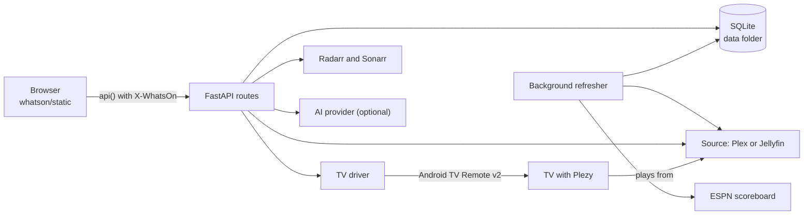

# Architecture

WhatsOn is one FastAPI process serving a plain JavaScript page. It keeps a local SQLite copy of a media server's guide and
library, joined with sports data, searches that copy, and starts things on TVs. The reasons are in the [ADRs](adr/README.md).

## Modules

### Start-up and shared objects

| Module | What it does |
|---|---|
| `whatson/app.py` | Start-up, background tasks, request checks, TV pairing, tuning and search routes |
| `whatson/state.py` | The objects routes share: database, HTTP clients, current source, drivers |
| `whatson/config.py` | Settings read once from environment variables |
| `whatson/db.py` | SQLite schema, connecting, and the `meta` settings table |

### Routes

| Module | What it does |
|---|---|
| `whatson/routes.py` | Now playing, guide, library, sports, follows, Trakt, suggestions |
| `whatson/remote_routes.py` | Remote tab, and the Jellyfin connection and direct control |
| `whatson/arr_routes.py` | Downloads settings, and finding and adding titles |
| `whatson/plex_routes.py` | Plex sign-in, pasted token, and renewal |
| `whatson/source_routes.py` | Choosing which server is in use |

### Data and search

| Module | What it does |
|---|---|
| `whatson/ingest.py` | The refresher: pulls data, links games to airings, rewrites tables |
| `whatson/search.py` | `Filters`, keyword reading, and the guide, library and game queries |
| `whatson/suggest.py` | Suggestion rows, chosen by rules and Trakt, re-ordered by AI when on |
| `whatson/ai.py` | The optional AI layer and its providers |
| `whatson/ai_settings.py` | Saved AI settings and keys |

### Outside systems

| Module | What it does |
|---|---|
| `whatson/sources/base.py` | The `Source` protocol and shared data types |
| `whatson/sources/plex.py` | Plex Media Server client |
| `whatson/sources/jellyfin.py` | Jellyfin client, including direct control of its apps |
| `whatson/sources/espn.py` | ESPN scoreboard feed and network matching |
| `whatson/devices/base.py` | The `TVDriver` protocol and pairing errors |
| `whatson/devices/androidtv.py` | Google TV and Android TV driver |
| `whatson/devices/__init__.py` | The saved list of TVs |
| `whatson/tune.py` | Plezy links and the busy check |
| `whatson/apps.py` | Apps the Remote tab knows, and which ones each TV has |
| `whatson/arr.py` | Radarr and Sonarr client: look up, add, search |
| `whatson/plex_auth.py` | Plex sign-in and saved Plex connection |
| `whatson/plex_users.py` | A Plex Home user for each TV: reading as them, and their watched status |
| `whatson/trakt.py` | Trakt sign-in and sync (⚙ → More → Trakt) |
| `whatson/safe_http.py` | The rules and client for addresses typed in Settings |

The front end has [its own page](frontend.md). Package markers: `whatson/__init__.py` holds the version, and
`whatson/sources/__init__.py` is otherwise empty.

## Background tasks

Started in `lifespan` in `whatson/app.py`. Each runs for the life of the process.

| Task | Every | What it does |
|---|---|---|
| `Refresher.run_forever` | Checks every 15 s | Games, then guide, then library, each on its own interval. Games go first so the guide can link them |
| `_trakt_loop` | 5 min | Trakt sync, which does nothing unless connected and due |
| `renew_loop` | 1 hour | Renews the Plex sign-in when it's due |
| `_drop_idle_loop` | 30 s | Closes Remote tab connections to TVs nobody has used |

Default intervals: games 5 minutes (30 seconds while a followed team or league is playing), guide 15 minutes, library
6 hours. A failed refresh retries after a minute. See [configuration](configuration.md).

## Main flows

### Refresh

1. Ask the source for its server id, and save it as `machine_id`. Plezy links need it.
2. Fetch games from ESPN for the configured and followed leagues. An empty result leaves the old games in place.
3. Load the guide from 3 hours ago to `GUIDE_HOURS` ahead. `link_games` matches sports listings to games
   ([ADR 0014](adr/0014-match-espn-games-to-listings.md)), and `write_guide` replaces the tables and search index in one
   transaction.
4. Load the library the same way.

If the source was switched while a load was running, the result is thrown away.

### Search

1. `GET /api/search` gets filters one of three ways: replayed from edited chips, read from the question by AI, or read
   from keywords. See [ADR 0015](adr/0015-filters-are-the-search-contract.md).
2. `search.run` queries games, the guide and the library over the local data.
3. When AI read the question, the front end then calls `GET /api/answer` for one line written from those matches only.
4. With Radarr or Sonarr set up, it also calls `GET /api/get/lookup` for titles you could get.

### Tuning

1. `POST /api/tune` builds a Plezy link for the channel or title.
2. Unless `force` is set, `tune.check_busy` looks at what the server reports and which app is in front. If the TV is busy,
   it answers 409 with code `busy`, the front end asks, and it sends the request again with `force`.
3. The driver opens the link on the TV. Plezy plays from the media server, not through WhatsOn.

### Pairing a TV

1. `POST /api/pair/start` checks for a private IP address, probes the TV and starts pairing. The TV shows a code.
2. `POST /api/pair/finish` sends the code. A wrong code ends the TV's pairing screen, so WhatsOn opens a new one.
3. The TV is saved. Its client certificate is the one shared by the whole install, kept in the data folder.

### Switching server

`PUT /api/settings/source` clears everything tied to the old server's ids, including favorite channels, points `state.source`
at the new one and tells the refresher to reload.

## Where to add things

[CONTRIBUTING.md](../CONTRIBUTING.md#common-additions) has recipes for a TV type, a Remote tab app, a sports league, a setting
that saves a key, a database column, and a screen.
